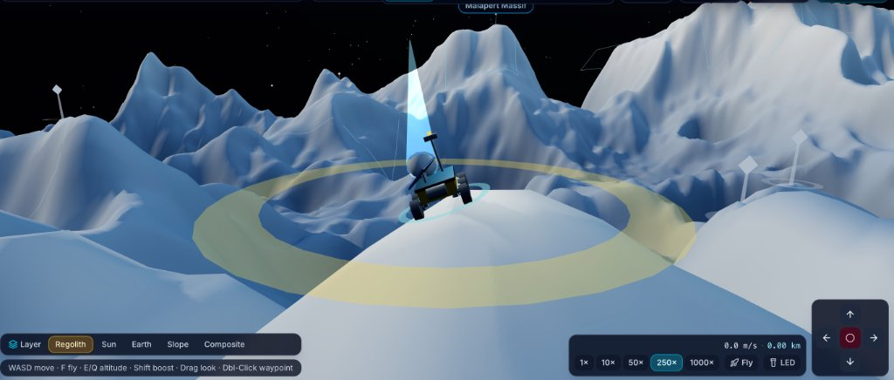

# VeriFour: Lunar Landing Site Navigator

Live demo: [click here](https://lunar.agentlens.dpdns.org/) https://lunar.agentlens.dpdns.org/ [](https://lunar.agentlens.dpdns.org/)

An interactive browser-based mission planning tool for evaluating solar illumination, Earth direct-to-Earth (DTE) line-of-sight visibility, and LRO LOLA South Pole topography across lunar landing sites and custom coordinates.

## What it is

**Lunar Landing Site Navigator** enables mission planners, engineers, and educators to explore when and where lunar surface sites receive sunlight and Earth DTE line-of-sight over 2026–2030 in a cosmic NASA Eyes / Moon Trek-inspired mission control workspace:

- **GPU-Accelerated 3D Lunar South Pole & Interactive Rover Simulator (`Lunar3DViewport.tsx`, `roverPhysics.ts`, `celestialSky.ts`):** Three.js WebGL terrain engine rendering a `250×250` South Pole LRO LOLA mesh (`±150 km`, selectable `1× Real` true 1:1 to `15×` relief) with `5` dynamic surface layers (`Regolith`, `Sun`, `Earth`, `Slope`, `Composite`), directional JPL Horizons solar shadows, an astrometric `J2000 ICRS` deep-space sky (`116` bright stars + `7,200` Galactic Milky Way stars, GLSL Milky Way band, and `7` nebulae/galaxies), a 3D Sun corona with eclipse dimming/reddening, a procedural 3D Earth globe with DTE beam, draped **9 Artemis III 2024 region boundaries**, and clickable 3D site beacons (`flyTo`). Drive an articulated 6-wheel rocker-bogie rover (`WASD` / Arrow keys / virtual HUD pad / click-on-terrain autopilot waypoints) with `1× / 10× / 50× / 250× / 1000×` gears, live pitch/roll terrain-normal slope alignment over bilinearly sampled `240 m/px` `dem_fine_240m.i16` (falling back smoothly to `1,200 m/px` coarse DEM), PSR LED headlights, a 160-point 3D traverse trail, and 4 camera modes (`Rover Chase`, `1st-Person Mast POV`, `Orbit`, `Free Cam` / `Tactical`), plus a synchronized **`Command Split`** workspace pairing 3D simulation with 2D cartography and 360° horizon sky views.
- **Cosmic Mission Control Workspace & 2D/Global Cartography:** Five workspace views (`3D Rover & Surface` default hero stage, `Command Split`, `2D Map & Sky`, `Compare A vs B`, `Candidate Directory`), `4` animated SVG `CircularRingGauge` telemetry readouts, a collapsible **`Science & Methodology Notes`** drawer, and a 3-tab Bottom Mission Dock (`14-Day Timeline & Sensitivity`, `360° Horizon Sky & Panorama`, `Rover Traverse Elevation Profile`), backed by the `±150 km` stereographic 2D map, `9` Artemis III 2024 polygons (`artemis3_regions.json`), precomputed `250×250` illumination/DTE maps (`polar_maps.json`), and a Global Moon view.
- **31 Curated Sites & Multi-Site Comparison:** Covers 13 South Pole sites (including Artemis III 2024 9-region coordinates), 10 Historic & International sites, 6 CLPS Commercial sites, and 2 Polar Reference / PSR sites evaluated across 5 mast heights (`0.5 m`, `2.0 m`, `10.0 m`, `20.0 m`, `50.0 m`), plus custom probe evaluation anywhere on the Moon using lazy-loaded binary LOLA DEMs, scenario comparison, and CSV/JSON export.
- **360° Horizon Panorama & 2026–2030 Timeline:** **36,216** hourly JPL Horizons ephemeris steps (`2026-11-14T00:00:00Z` to `2030-12-31T23:00:00Z`) including **9 Moon-center eclipse intervals**, instantaneous Sun/Earth azimuth and elevation horizon clearance, geometric eclipse obscuration, modeled solar array power fractions, countdowns, and mission-window operational intervals.
- **Computed Candidate Discovery (`site_candidates.json` + Live Worker):** Mode A filters and ranks precomputed `250×250` (`1,200 m/px`) illumination/DTE/slope layers and **140** refined `5×5` (`240 m/px`) blocks at `2.0 m` mast height over `36,216` hours; Mode B executes live multi-resolution `scanAroundLive` queries in a Web Worker against the binary LOLA DEM grids.
- **Static Client-Side Execution:** Runs completely in the browser against static precomputed JSON and Int16 binary assets in `webapp/public/data/`—no backend server or runtime JPL Horizons requests.

## Live demo & submission package

- **Live Web Application URL:** `https://lunar.agentlens.dpdns.org/`
- **Submission Package (`submission/`):**
  - [`submission/NASA_SUBMISSION_FORM.md`](submission/NASA_SUBMISSION_FORM.md) — Complete copy-paste text and verified `https://` data citation tables for the NASA Space Apps Challenge 2026 portal (`Team VeriFour`).
  - [`submission/USE_OF_AI_AND_SI_DISCLOSURE.md`](submission/USE_OF_AI_AND_SI_DISCLOSURE.md) — Transparent disclosure of AI / Super Intelligence (SI) tools, assisted engineering areas, and human scientific verification.
  - [`submission/PITCH_DECK_7_SLIDES.pdf`](submission/PITCH_DECK_7_SLIDES.pdf) & [`submission/PITCH_DECK_7_SLIDES.html`](submission/PITCH_DECK_7_SLIDES.html) — Self-contained 7-slide 16:9 visual pitch deck (with live NASA LOLA / JPL Horizons captures).
  - [`submission/PITCH_AND_VIDEO_SCRIPT.md`](submission/PITCH_AND_VIDEO_SCRIPT.md) — 30-second video capture script, 5–7 minute live judging pitch guide, Viability MCDA justification, and submission checklist.

## Raw NASA data used (`data/`)

The `data/` folder holds the raw NASA inputs consumed by the offline pipeline (`scripts/`), which turns them into the shipped runtime assets in `webapp/public/data/`:

| Path | NASA source | How it is used |
| --- | --- | --- |
| `data/lola/ldem_75s_240m.lbl` (+ `ldem_75s_240m.img`, 29 MB, downloaded by `scripts/fetch_lola_dem.py` and gitignored) | NASA PDS LRO LOLA Gridded Data Record `LDEM_75S_240M` | 240 m/px South Pole (75°S–90°S) elevation grid → `dem_fine_240m.i16`, `dem_coarse_1200m_max.i16`, slope maps and 360° horizon ray-marching |
| `data/horizons/moon_subpoints_1h.csv` | NASA JPL Horizons (`DE441` / `MOON_ME`) | Hourly sub-solar and sub-Earth points and Earth–Moon distance (`36,216` steps, `2026-11-14`–`2030-12-31`) → `ephemeris.json` |
| `data/horizons/topo_*_sun.csv`, `topo_*_earth.csv` (12 files) | NASA JPL Horizons topocentric observer tables | Az/El validation checkpoints at 6 sites (Apollo 11, Chandrayaan-3, Chang'e-4 far side, Connecting Ridge, IM-1 Odysseus, IM-2 Athena); max error `0.000198°` (Sun) / `0.006016°` (Earth) |
| `data/artemis3_regions_2024.csv`, `data/artemis3_regions_2024.geojson` | NASA Artemis III 2024 candidate landing regions (via LROC QuickMap) | 9 region boundaries → `artemis3_regions.json` and the map/3D overlays |

Re-fetch the raw data with `scripts/fetch_lola_dem.py` and `scripts/fetch_horizons.py` (see *How to run*). Source URLs are listed under *Data sources*.

## Shipped data assets (`webapp/public/data/`, schema v2.0.0)

All shipped runtime files share `schema_version: "2.0.0"` and `data_version: "2026-11-14"`:

| Asset                        | Purpose                                           | Key Parameters                                                                                                                                 |
| ---------------------------- | ------------------------------------------------- | ---------------------------------------------------------------------------------------------------------------------------------------------- |
| `ephemeris.json`           | 1-hour lunar ephemeris & eclipse catalog          | `36,216` steps (`2026-11-14T00:00:00Z`–`2030-12-31T23:00:00Z`), `9` Moon-center eclipses, Horizons validation metadata                |
| `sites.json`               | Curated site metrics & terrain summaries          | `31` curated sites across `5` mast heights (`0.5, 2.0, 10.0, 20.0, 50.0` m); `17` with `LOLA_240M` terrain coverage, `14` `NONE` |
| `artemis3_regions.json`    | Artemis III 2024 candidate region boundaries      | `9` regions (`CB, HW, MA, MP, MM, N1, N2, G2, SP`) with `rings_polar_km` & `polygon_lonlat`                                            |
| `polar_dem_patch.json`     | Initial coarse elevation & slope layer            | `250×250` grid (`1,200 m/px`, `±150 km`)                                                                                               |
| `dem_manifest.json`        | Binary DEM coordinate & scale metadata            | Little-endian `int16` metadata (`R0 = 1,737,400.0 m`)                                                                                      |
| `dem_fine_240m.i16`        | High-resolution South Pole DEM (`3,125,000` B)  | `1250×1250` @ `240 m/px` (`±150 km`)                                                                                                   |
| `dem_coarse_1200m_max.i16` | Extended South Pole horizon DEM (`1,161,288` B) | `762×762` @ `1,200 m/px` (`5×5` block-max across `75°S–90°S`)                                                                     |
| `polar_maps.json`          | Precomputed illumination & DTE layers             | `250×250` grid (`1,200 m/px`, `2.0 m` mast, highest `240 m` pixel per `1.2 km` cell)                                                |
| `site_candidates.json`     | Precomputed WP7 Mode A discovery & blocks         | `250×250` multi-layer maps (`2.0 m` mast, `36,216` h) + `140` refined `5×5` (`240 m/px`) pixel blocks                            |

## How to run

### Web application (`webapp/`)

Requires Node.js (v20+ / v22+ / v24+) and npm.

```bash
cd webapp
npm install
npm run dev
```

Verification and production build commands:

```bash
cd webapp
npm run typecheck
npx tsc -p tsconfig.test.json --noEmit
npm test
npm run build
npm run preview
```

### Offline data pipeline (`scripts/`)

Requires Python 3.13+ (or 3.11+) and the runtime/test dependencies listed in `requirements-pipeline.txt` (`numpy`, `pandas`, `scipy`, `requests`, `pytest`).

```bash
python -m venv .venv
# Activate .venv, then:
pip install -r requirements-pipeline.txt
python scripts/fetch_lola_dem.py --out-dir data/lola
python scripts/fetch_horizons.py --out-dir data/horizons
python scripts/build_unified_data.py
python -m unittest discover -s tests -v
pytest -v
```

*(Note: `test_binary_dem_and_center_patch_match_raw_lola` in `tests/test_pipeline_invariants.py` automatically skips in environments such as CI where the gitignored 29 MB raw LOLA `data/lola/ldem_75s_240m.img` has not been fetched locally, and validates binary DEM byte parity once `fetch_lola_dem.py` has downloaded it.)*

## Verification summary (shipped build)

- **JPL Horizons DE441 / `MOON_ME` Topocentric Az/El Validation (6 lunar validation sites, `2026-11-14T00:00:00Z`–`2030-12-31T23:00:00Z`):**
  - Pipeline `ephemeris.json` validation across all 6 sites (`36,216` hourly steps): `sun_max_err_deg = 0.000198°` (`<= 0.0002°`), `earth_max_err_deg = 0.006016°` (`<= 0.0061°`).
  - Client JS fixture suite `webapp/tests/azel.horizons.test.ts` (794 sampled hourly points per site across 6 sites): max Sun error `0.000198°`, max Earth error `0.006014°`.
- **Python Pipeline Invariant Tests (`tests/test_pipeline_invariants.py`):**
  - `python -m unittest discover -s tests -v`: 10/10 tests OK.
  - `python -m pytest -v`: 10/10 passed.
- **Webapp Typecheck, Tests & Production Bundle (`webapp/`):**
  - `npm run typecheck` (`tsc --noEmit`) and `npx tsc -p tsconfig.test.json --noEmit`: 0 errors.
  - `npm test` (`vitest run`): `67 passed | 34 todo (101 total)` across `13` test files (`7` active test suites passed: `wp3.map.test.ts` 13, `azel.horizons.test.ts` 6, `wp8.rover3d.test.ts` 12, `wp4.sky.test.ts` 8, `wp5.app.test.ts` 7, `wp7.candidates.test.ts` 5, `wp2.core.test.ts` 16; `6` scaffold `.acceptance.test.ts` suites hold `34` `.todo` placeholders).
  - `npm run build` (`tsc -b && vite build`): exit 0, `1,601` modules transformed cleanly into `webapp/dist/`.

*(Continuous integration runs these webapp and pipeline checks automatically on push/PR via `.github/workflows/ci.yml`.)*

## Data sources

- **NASA JPL Horizons System (`DE441` / `MOON_ME` frame):** `https://ssd.jpl.nasa.gov/api/horizons.api` (documentation: `https://ssd-api.jpl.nasa.gov/doc/horizons.html`) — hourly sub-solar and sub-Earth point ephemeris, Earth-Moon distance, and topocentric validation checkpoints (retrieved November 2026).
- **NASA LRO LOLA Gridded Data Record (`LDEM_75S_240M` & `AVGVISIB`):** `https://pds-geosciences.wustl.edu/lro/lro-l-lola-3-rdr-v1/lrolol_1xxx/data/lola_gdr/polar/img/` and `https://pds-geosciences.wustl.edu/lro/lro-l-lola-3-rdr-v1/lrolol_1xxx/extras/illumination/img/` — 240 m/px polar stereographic lunar South Pole elevation grid (75°S–90°S) and PDS average solar visibility cross-check rasters.
- **NASA Artemis III Candidate Landing Regions (2024 9-Region Update & 2022 13-Region Release) & GSFC PGDA:** `https://www.nasa.gov/news-release/nasa-provides-update-on-artemis-iii-moon-landing-regions/`, `https://www.nasa.gov/news-release/nasa-identifies-candidate-regions-for-landing-next-americans-on-moon/`, and `https://pgda.gsfc.nasa.gov/products/78`.
- **Artemis III 2024 Candidate Landing Regions GeoJSON (via LROC QuickMap):** `https://quickmap.lroc.asu.edu/` (`https://files.actgate.com/lunar/A3_9regions-lonlat-simplified.geojson`) — 9 region boundary polygons and centroids.
- **Cartographic & Space Agency Partner References:** NASA Moon Trek (`https://trek.nasa.gov/moon/`), NASA NSSDCA Lunar Sites Catalog (`https://nssdc.gsfc.nasa.gov/planetary/lunar/lunar_sites.html`), Canadian Space Agency Moon Exploration (`https://www.asc-csa.gc.ca/eng/astronomy/moon-exploration/`), and IAU/USGS Gazetteer of Planetary Nomenclature (`https://planetarynames.wr.usgs.gov/Feature/5450`).
- **Curated landing site coordinates & literature benchmarks:** Authoritative mission/agency press kits and peer-reviewed publications recorded per-site in `provenance.source_url` inside `webapp/public/data/sites.json`, cross-checked against Mazarico et al. (2011, `https://doi.org/10.1016/j.icarus.2010.10.030`), De Rosa et al. (2012, `https://doi.org/10.1016/j.pss.2012.08.002`), Gläser et al. (2014, `https://doi.org/10.1016/j.icarus.2014.08.013`; 2018, `https://doi.org/10.1016/j.pss.2017.07.006`), and Barker et al. (2021, `https://doi.org/10.1016/j.pss.2020.105119`; 2023, `https://doi.org/10.3847/PSJ/acf3e1`).

*(Data Used vs. Context Referenced: Historical, CLPS, commercial, and international targets such as Apollo, Surveyor, Luna, ISRO Chandrayaan-3, JAXA SLIM, and CNSA Chang'e are referenced by published coordinates only and evaluated uniformly over NASA JPL Horizons and LRO LOLA geometry; no external agency raster/ephemeris datasets are ingested unless explicitly listed above.)*

## Method and definitions

- **Solar & Earth Azimuth/Elevation:** Computed in the local East-North-Up (ENU) frame on the `MOON_ME` sphere (`R0 = 1737.4 km`) from JPL Horizons sub-points and verified against JPL Horizons topocentric checkpoints (`<= 0.0002°` Sun, `<= 0.0061°` Earth).
- **Terrain Horizon & Mast Height:** 360° spherical great-circle ray-marching at 1° azimuth resolution over 480 log-spaced steps from 120 m to 200 km (`LOLA_240M` inside ±150 km, `LOLA_1200M_COARSE` block-max outside ±150 km up to 75°S). Outside LOLA polar coverage (`terrain_source = "NONE"`), terrain metrics are `null` and the smooth-sphere horizon dip is `-acos(R0 / (R0 + h_mast))`.
- **Sun & Earth Visibility Definitions:**
  - `sun_time_pct`: percentage of hours with any portion of the 0.266° solar disk above the terrain horizon (`disk_frac > 0`).
  - `sun_visible_pct`: time-averaged visible solar disk fraction (`× 100`).
  - `earth_visible_pct`: percentage of hours with Earth's center above terrain horizon plus configurable elevation mask (default `0°`).
  - `both_visible_pct`: percentage of hours satisfying both `disk_frac > 0` and Earth visibility (`<= min(sun_time_pct, earth_visible_pct)`).
- **Geometric Eclipse Approximation:** When Earth passes near the Sun from a site's viewpoint, disk obscuration is computed from the two-circle intersection of Earth's apparent angular radius `asin(6378.137 km / dist_km)` and the solar disk (`0.266°`), ignoring Earth's atmosphere.
- **Relative Array Power (Model):** Expressed as `%` of a sun-tracking perpendicular panel at full solar disk: vertical Sun-tracking = `effective_disk_frac * 100`; horizontal panel = `effective_disk_frac * max(0, sin(sun_el)) * 100` (excludes dust, temperature, cell efficiency, and lander self-shadowing).
- **Composite Viability Score (Team-Defined Index, Not a NASA Standard):** `0.35*sun_visible_pct + 0.25*earth_visible_pct + 0.15*both_visible_pct + 0.15*dark_score + 0.10*pct_safe_hls_le_5deg`, where `dark_score = max(0, 100 * (1 - min(max_dark_days, 30) / 30))` and `pct_safe_hls_le_5deg` measures pixels with 240 m baseline slope `<= 5°` within a `30×30 km` box. Returns `null` / `n/a` when `terrain_stats` is `null`.

## Known limitations

- **240 m/px terrain & rover simulation baseline:** LOLA `LDEM_75S_240M` (and the `250×250` 3D viewport mesh) does not resolve meter-scale hazards, boulders, small craters, regolith bearing physics, or lander-footpad slopes; viability scores, candidate rankings, and rover pitch/roll kinematics provide exploratory geometric and decision-support simulation fidelity, not engineering landing certification or terramechanics validation.
- **South Pole DEM boundary:** Local topography is only available south of 75°S (`LDEM_75S_240M`); sites north of 75°S use smooth-sphere horizon dip geometry and report `n/a` for terrain statistics.
- **Hourly ephemeris cadence:** Ephemeris steps are 1 hour; horizon crossing timings are quantized to the hourly grid unless interpolated.
- **Eclipse atmosphere omission:** Earth penumbral/umbral atmospheric refraction and reddening are not modeled.
- **Array power idealization:** Relative array power values reflect geometric disk fraction and incidence angle only, omitting thermal, dust, cell efficiency, and hardware self-shadowing effects.

## Use of AI tools & Super Intelligence (SI) disclosure

In compliance with NASA Space Apps Challenge 2026 rules, **Team VeriFour** discloses all AI / Super Intelligence (SI) tools used in developing this project (detailed breakdown in [`submission/USE_OF_AI_AND_SI_DISCLOSURE.md`](submission/USE_OF_AI_AND_SI_DISCLOSURE.md)):

1. **Pre-Event Exploratory Research (`2026-11-13`):** **Google Antigravity IDE (Gemini)** and **Anthropic Claude Code (Claude)** assisted in reviewing lunar axial tilt and horizon physics, verifying JPL Horizons `MOON_ME` sub-point azimuth/elevation equations (`<= 0.006°`), benchmarking `240 m/px` LRO LOLA ray-marching, and structuring modular work-package specifications (`WP0–WP7`).
2. **Official Hackathon Build (`2026-11-14` after `09:00 GMT+7`, clean repository `NASA-Space-Apps-Challenge-2026`):** **Google Antigravity IDE** (multi-agent coding workflow using **Google Gemini** and **Anthropic Claude** models, paired with **Chrome DevTools MCP** for live browser visual/interactive QA) assisted in implementing the Python data pipeline, React 18 / TypeScript / Tailwind v4 cosmic web application, GPU Three.js 3D lunar rover simulator and J2000 sky (`Lunar3DViewport.tsx`, `roverPhysics.ts`, `celestialSky.ts`), Web Worker candidate scanner, automated test suites (`10` Python invariant tests and `67` active Vitest unit/integration tests + `34` todo scaffolds), and English documentation.
3. **Zero AI-Generated Media or Synthetic Scientific Data:** **Zero (0) AI-generated images, videos, voiceovers, imported 3D meshes, or synthetic terrain textures** were used anywhere in this repository or presentation deck (3D rover chassis, procedural regolith detail, and Earth/Sun shaders are built programmatically from Three.js primitives and Canvas gradients). All elevation grids, horizon profiles, illumination percentages, and eclipse calculations derive strictly from official **NASA LRO LOLA (`LDEM_75S_240M`)** and **NASA JPL Horizons (`DE441` / `MOON_ME`)** datasets under human scientific direction and verification by **Team VeriFour**.

## Third-party code and references

Web application dependencies (`webapp/package.json`):

- `react`, `react-dom` (`^18.3.1`) — MIT
- `three` (`^0.187.0`), `@types/three` (`^0.187.0`) — MIT
- `lucide-react` (`^0.468.0`) — ISC
- `tailwindcss`, `@tailwindcss/vite` (`^4.0.0`) — MIT
- `vite` (`^6.0.5`), `@vitejs/plugin-react` (`^4.3.4`) — MIT
- `typescript` (`~5.6.2`) — Apache-2.0
- `vitest` (`^3.2.7`) — MIT
- `@types/node` (`^22.10.0`), `@types/react` (`^18.3.12`), `@types/react-dom` (`^18.3.1`) — MIT

Python pipeline dependencies (`requirements-pipeline.txt`):

- `numpy`, `pandas`, `scipy` — BSD-3-Clause
- `requests` — Apache-2.0
- `pytest` — MIT

## License

Copyright 2026 **Team VeriFour**. Licensed under the **Apache License, Version 2.0** (`Apache-2.0`) — see [`LICENSE`](LICENSE) for full terms and conditions.
